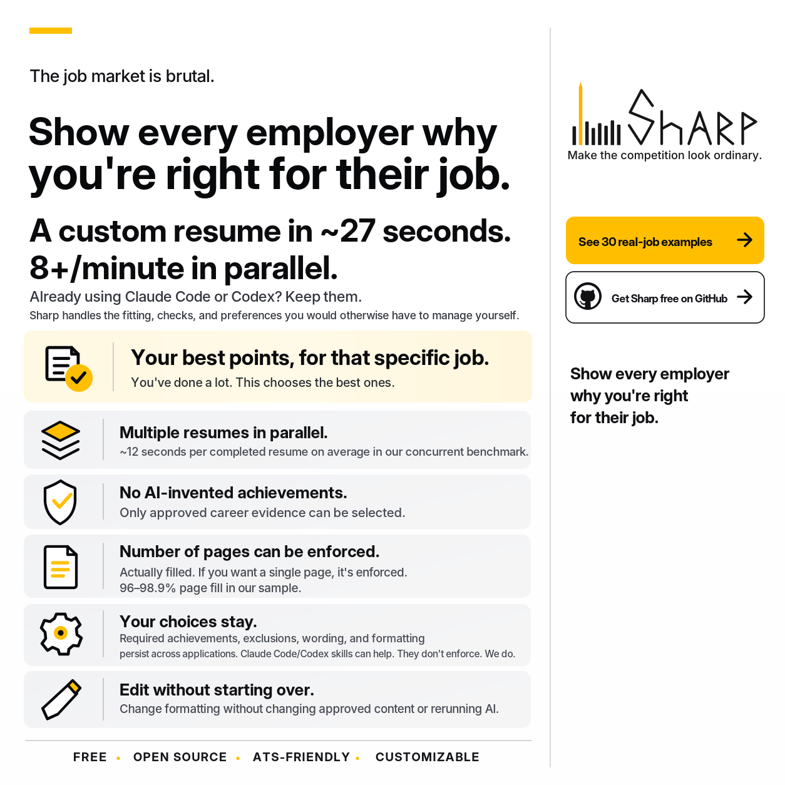

# Sharp

[**See 30 real-job examples**](https://the-will-of-ed.github.io/sharp/) | [**Download all examples**](samples/roran-stronghammer/Roran%20StrongHammer%20-%2030%20Resumes.zip) | [**Get Sharp on GitHub**](https://github.com/The-Will-of-Ed/sharp)

## Start with the agent you already use

Clone or download this repository and open it in Claude Code or Codex. Then say:

> Follow AGENTS.md and docs/SETUP.md. Set up Sharp in its own environment, connect its MCP tools, and verify them. Read the resumes and notes I point you to, consolidate them into one proposed career master, and show me before applying changes. Keep my originals unchanged and my data out of Git.

Then paste a posting or give its URL:

> Make a one-page resume for this job from my approved career evidence. Keep my saved preferences, inspect the fit and PDF preview, and give me the finished file.

For edits:

> Increase the section spacing and put my profile links on one line with a bar between them. Keep the selected content unchanged. Refit and check the PDF.

**Needs:** Git, Python 3.12+, and your installed, signed-in agent. No separate model API key is required when your current agent makes the choices. Host permissions or an MCP restart may be needed during setup.

[Full setup: Windows, macOS, and Linux](docs/SETUP.md) | [CLI, editing, settings, and exports](docs/USAGE.md) | [Try the no-AI demo](docs/USAGE.md#try-it)

## Explore and customize

The [gallery](https://the-will-of-ed.github.io/sharp/) includes 30 resume PDFs, previews, and saved employer postings. [Download the full bundle](samples/roran-stronghammer/Roran%20StrongHammer%20-%2030%20Resumes.zip), or open `samples/roran-stronghammer/index.html` locally.

[Sample career master](samples/roran-stronghammer/fixture/master.yaml) | [Sample settings](samples/roran-stronghammer/fixture/settings.json) | [Saved selections](samples/roran-stronghammer/selections) | [Editing and exports](docs/USAGE.md#edit-resume-export)

[Full usage guide](docs/USAGE.md) | [Architecture](docs/architecture.svg) | [Contracts](docs/CONTRACTS.md) | [Custom rules](docs/RULES.md) | [Validation](docs/VALIDATION.md) | [Recorded AI-inclusive benchmarks](samples/roran-stronghammer/benchmark-summary.json)

Sharp is MIT-licensed software. Agent subscriptions and optional API charges still apply. Benchmark timings start with ready career data and saved job postings; individual latency and concurrent batch throughput are different measurements. The sample profile is invented and the postings are employer-published snapshots. Page-fill targets are measured, not guaranteed. ATS-friendly does not guarantee a particular ATS score or hiring outcome.
